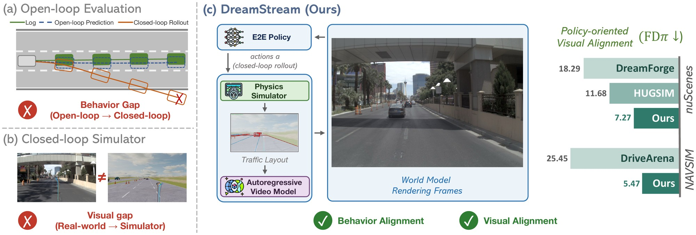

> ## DreamStream: Towards Policy-Oriented Generative Simulation for End-to-End Driving
>
> ### [[Paper]](https://arxiv.org/abs/2609.26792) [[Project Page]](https://vail-ucla.github.io/DreamStream/)
>
> **[Ziyang Leng](https://matthew-leng.github.io/)**<sup>1,&#42;</sup>,
> **[Sicheng Mo](https://sichengmo.github.io/)**<sup>1,&#42;</sup>,
> [Seth Z. Zhao](https://sethzhao506.github.io/)<sup>1</sup>,
> [Haoyuan Cai](https://haoyuancai.github.io/)<sup>1</sup>,
> [Yu Zeng](https://zengxianyu.github.io/)<sup>2</sup>,
> [Rowan McAllister](https://rowanmcallister.github.io/)<sup>2</sup>,
> [Bolei Zhou](https://boleizhou.github.io/)<sup>1</sup>
>
> <sup>1</sup>University of California, Los Angeles &nbsp;&nbsp; <sup>2</sup>Toyota Research Institute &nbsp;&nbsp; <sup>&#42;</sup>Equal contribution

<div align="center">



</div>

---

DreamStream is a generative closed-loop simulator for end-to-end driving
policies. A physics simulator executes the policy's plan and renders traffic
layouts; a few-step autoregressive video model turns those layouts into camera
frames that the policy consumes in the next step.

## Code Release

This repository has three parts:

| Folder | Component | Status |
|---|---|---|
| [`DreamStream/`](DreamStream) | Video generation model | available |
| [`BridgeSim/`](BridgeSim) | Physics simulator and closed-loop evaluation ([VAIL-UCLA/BridgeSim `dreamstream` branch](https://github.com/VAIL-UCLA/BridgeSim/tree/dreamstream)) | available |
| [`FDpi/`](FDpi) | FDπ metric for the visual gap | available |

Clone with submodules:

```bash
git clone --recursive https://github.com/VAIL-UCLA/DreamStream.git
# or, in an existing clone:
git submodule update --init
```

Model checkpoints are hosted at [`UCLA-VAIL/DreamStream`](https://huggingface.co/UCLA-VAIL/DreamStream) on Hugging Face.
See [`DreamStream/README.md`](DreamStream/README.md) to set up and run the video model, and [`BridgeSim/docs/dreamstream.md`](https://github.com/VAIL-UCLA/BridgeSim/blob/dreamstream/docs/dreamstream.md) for the simulator and closed-loop evaluation, and [`FDpi/README.md`](FDpi/README.md) to compute FDπ for your own generated frames.

## License

See [LICENSE](LICENSE) and [NOTICE](NOTICE). The release is for
non-commercial use only.

## Citation

```bibtex
@inproceedings{leng2026dreamstream,
  title     = {{DreamStream: Towards Policy-Oriented Generative Simulation for End-to-End Driving}},
  author    = {Leng, Ziyang and Mo, Sicheng and Zhao, Seth Z. and Cai, Haoyuan and Zeng, Yu and McAllister, Rowan and Zhou, Bolei},
  booktitle = {Conference on Robot Learning (CoRL)},
  year      = {2026}
}
```
